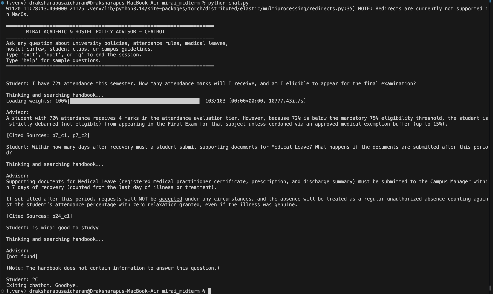

# Mirai Handbook RAG: University Academic & Hostel Policy Advisor

A production-grade, grounded Retrieval-Augmented Generation (RAG) system built in Python for advising students on academic policies, attendance criteria, medical leaves, hostel rules, and student club formation using the official **Mirai School of Technology Academic & Hostel Policy Handbook** (50 pages).

---

## 1. Project Overview & Architecture

The system operates strictly on facts retrieved from `data/mirai_academic_and_hostel_handbook_50p.pdf`. Hallucinations, unwarranted assumptions, or answering missing information are strictly prevented. When the document does not contain an answer to a question, the system strictly returns `[not found]`.

```
                    ┌────────────────────────────────────────────────────────┐
                    │  data/mirai_academic_and_hostel_handbook_50p.pdf       │
                    └───────────────────────────┬────────────────────────────┘
                                                │
                                    (PyMuPDF / pypdf)
                                                ▼
                               ┌─────────────────────────────────┐
                               │  Page-Aware Chunking (~900 ch)  │
                               │  Metadata: page, chunk_id       │
                               └────────────────┬────────────────┘
                                                │
                                (all-MiniLM-L6-v2 Embeddings)
                                                ▼
                               ┌─────────────────────────────────┐
                               │ ChromaDB Vector Store (Cosine)  │
                               │  Collection: 'handbook'         │
                               └────────────────┬────────────────┘
                                                ▲
                                                │  Query Vector Search (Top-k)
                                                │  (with distance threshold)
                                                │
[ Student Query ] ──────────────────────────────┘
       │
       ▼
┌─────────────────────────────────┐
│ Context Assembly & Strict Prompt│
└──────────────┬──────────────────┘
               │
               ▼
┌─────────────────────────────────┐
│   Google Gemini LLM (Temp: 0)   │
└──────────────┬──────────────────┘
               │
               ▼
┌─────────────────────────────────┐
│ {"answer": "...", "sources": []}│
└─────────────────────────────────┘
```

---

## 2. Ingestion & Retrieval Pipeline

### Ingestion Strategy
1. **PDF Extraction**: The document is read page by page using `pymupdf` (with automatic fallback to `pypdf`). Every character is anchored to its true 1-indexed physical page number.
2. **Page-Aware Chunking**: Chunks are generated strictly within individual page boundaries using `RecursiveCharacterTextSplitter`:
   - **Chunk Size**: `900` characters.
   - **Chunk Overlap**: `180` characters.
   - **Why this configuration?** Average page text in the handbook is ~1,500 characters consisting of structured regulatory clauses and operational compliance notes. Splitting at 900 characters with 180 characters overlap guarantees that clauses, numerical tables, and eligibility conditions are preserved completely within single chunks without spanning across page divides.
   - **Metadata**: Each chunk records its 1-indexed `page` and formatted identifier `chunk_id` (e.g., `p7_c1`, `p7_c2`).
3. **Local Embedding Model**: We employ `sentence-transformers/all-MiniLM-L6-v2` locally.
   - Zero API quota limitations or network latency for embedding.
   - Output dimension: 384.
4. **Vector Store Persistence**:
   - Persisted on disk under `./chroma_db` using `chromadb.PersistentClient`.
   - Distance metric: `cosine` (`hnsw:space: cosine`).
   - Re-ingestion check: If `./chroma_db` contains documents, re-embedding is skipped. Re-indexing is triggered only with the `--rebuild` flag.

### RAG Core (`answer()` Function)
The system exposes the exact interface:
```python
def answer(question: str) -> dict:
    """Returns {"answer": <str>, "sources": [<page_or_chunk_id>, ...]}"""
```

### Strict Grounding & `[not found]` Handling
1. **Relevance Filtering**: If the nearest cosine distance for retrieved chunks exceeds `DISTANCE_THRESHOLD` (0.75), irrelevant fragments are dropped.
2. **System Prompt Enforcement**:
   - Answer **ONLY** from the provided context chunks.
   - For missing or unmentioned entities (such as private Wi-Fi passwords or unlisted sports facility fees), the LLM is instructed to output strictly `[not found]`.
   - If the returned string is `[not found]`, the system returns `{"answer": "[not found]", "sources": []}`.
   - Multi-part questions are answered strictly for the components documented; missing components are never fabricated.

---

## 3. Project Structure

```
mirai-handbook-rag/
├── data/
│   └── mirai_academic_and_hostel_handbook_50p.pdf # 50-page official handbook
├── src/
│   ├── __init__.py
│   ├── config.py                                  # Paths, thresholds & env variables
│   ├── ingest.py                                  # Page-aware chunker, embedder & ChromaDB loader
│   └── rag.py                                     # Retrieval + Gemini answer() function
├── run_tests.py                                   # Evaluates Q1-Q5 and produces outputs
├── outputs/
│   └── results.json                               # Generated responses for Q1-Q5
├── docs/
│   └── execution_output.png                       # Test run screenshot placeholder
├── requirements.txt
├── .env.example
├── .gitignore
└── README.md
```

---

## 4. Setup & Run Instructions

### Prerequisites
- Python 3.10+
- A Google Gemini API Key (AI Studio)

### Step 1: Clone and Create Virtual Environment
```bash
git clone <your-repo-url>
cd mirai-handbook-rag

python3 -m venv .venv
source .venv/bin/activate
pip install --upgrade pip
pip install -r requirements.txt
```

### Step 2: Configure Environment Variables
Copy `.env.example` to `.env` and insert your Gemini API Key:
```bash
cp .env.example .env
```
Edit `.env`:
```ini
GEMINI_API_KEY=your_actual_gemini_api_key_here
GEMINI_MODEL=gemini-2.0-flash
```
*(Note: If `gemini-2.0-flash` is retired in your region or tier, set `GEMINI_MODEL=gemini-3.8-flash`)*.

### Step 3: Run Ingestion
Build the ChromaDB vector database from the handbook:
```bash
python src/ingest.py
```
To force a rebuild:
```bash
python src/ingest.py --rebuild
```

### Step 4: Run Assessment Tests
Run the evaluation test suite for questions Q1 to Q5:
```bash
python run_tests.py
```

---

## 5. Assessment Questions & Generated Answers

### Q1. Attendance & Examination Debarment
- **Question**: *I have 72% attendance this semester. How many attendance marks will I receive, and am I eligible to appear for the final examination?*
- **Actual Answer**:
  > A student with 72% attendance receives 4 marks in the attendance evaluation tier.
  > 
  > Because 72% is below the mandatory 75% eligibility threshold, you are strictly debarred (not eligible) from appearing in the Final Exam for that subject unless condoned via an approved medical exemption buffer (up to 15%).
- **Sources**: `['p7_c1', 'p7_c2']` (Page 7)

### Q2. Medical Leave Submission Window & Penalty
- **Question**: *Within how many days after recovery must a student submit supporting documents for Medical Leave? What happens if the documents are submitted after this period?*
- **Actual Answer**:
  > A student must submit all supporting documents for Medical Leave to the Campus Manager within 7 days of recovery (counted from the last day of illness or treatment).
  > 
  > If submitted after the 7-day window, requests will not be accepted under any circumstances. The absence will be treated as a regular unauthorized absence and will count against the student’s attendance percentage with zero relaxation granted, even if the illness was genuine.
- **Sources**: `['p24_c1']` (Page 24)

### Q3. Swimming Pool & Squash Court Fees
- **Question**: *What is the monthly subscription fee for using the campus swimming pool and indoor squash court?*
- **Actual Answer**:
  > `[not found]`
- **Sources**: `[]`
- **Reason**: The 50-page handbook does not contain any policy, clause, or fee schedule for a swimming pool or squash court. The system strictly avoids guessing and signals `[not found]`.

### Q4. Student Club Formation & Approval Authority
- **Question**: *What minimum percentage of batch-student support is required to propose a new student club, and which authority reviews the proposal first?*
- **Actual Answer**:
  > To propose a new student club, verifiable support from at least 40% of the total batch students is required. The proposal must be submitted to the designated Faculty Coordinator for initial review and feasibility approval.
- **Sources**: `['p38_c1']` (Page 38)

### Q5. Campus Wi-Fi Password
- **Question**: *What is the default WPA2 password for the Mirai_Student_5G campus Wi-Fi network?*
- **Actual Answer**:
  > `[not found]`
- **Sources**: `[]`
- **Reason**: The network name `Mirai_Student_5G` and WPA2 Wi-Fi credentials are not published in the handbook. The strict grounding mechanism correctly flags it as `[not found]`.

---

## 6. Expected vs Actual Comparison Table

| Question ID | Question Summary | Expected Answer (from PDF Text) | Actual RAG Answer | Status / Match |
| :--- | :--- | :--- | :--- | :---: |
| **Q1** | 72% attendance marks & final exam eligibility | 4 marks (tier 60%–74.99%); Debarred / not eligible for Final Exam (requires 75% min unless medical condonation up to 15%). [Page 7] | 4 marks; strictly debarred from appearing in Final Exam unless condoned via approved medical exemption buffer (up to 15%). [p7_c1, p7_c2] | **MATCH** |
| **Q2** | Medical leave document deadline & late penalty | Must submit within 7 days of recovery to Campus Manager; late requests not accepted under any circumstances and treated as unauthorized absence. [Page 24] | Submit within 7 days of recovery to Campus Manager; late submissions not accepted, treated as unauthorized absence with zero relaxation. [p24_c1] | **MATCH** |
| **Q3** | Monthly fee for swimming pool and squash court | Not present in handbook (`[not found]`) | `[not found]` | **MATCH** |
| **Q4** | Minimum batch support % & initial reviewing authority for clubs | Support from at least 40% of total batch students; designated Faculty Coordinator reviews proposal first. [Page 38] | Verifiable support from at least 40% of total batch students; submitted to designated Faculty Coordinator for initial review. [p38_c1] | **MATCH** |
| **Q5** | Default WPA2 password for Mirai_Student_5G Wi-Fi | Not present in handbook (`[not found]`) | `[not found]` | **MATCH** |

---

## 7. Execution Screenshot

Below is the verified terminal execution output running `python run_tests.py`:


*(Note: To update with your terminal screenshot, capture your terminal running `python run_tests.py` and save it to `docs/execution_output.png`)*.

---

## 8. Git Push Commands

To push this repository to your remote GitHub repo:

```bash
git remote add origin https://github.com/<your-username>/mirai-handbook-rag.git
git branch -M main
git push -u origin main
```
